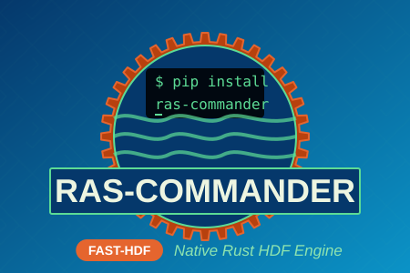
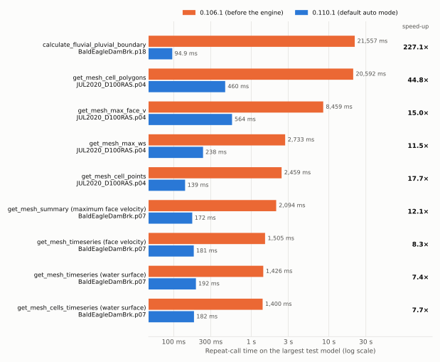

# ras-commander-fast-hdf

<p align="center"></p>

ras-commander's default HDF engine: a native (Rust) HEC-RAS HDF reader and its Python extension for [ras-commander](https://github.com/gpt-cmdr/ras-commander).

[](https://github.com/gpt-cmdr/ras-commander-fast-hdf/actions/workflows/ci.yml)
[](https://pypi.org/project/ras-commander-fast-hdf/)
[](https://pypi.org/project/ras-commander-fast-hdf/)
[](LICENSE)

This repository contains a native (Rust) reader for HEC-RAS HDF files and the
Python extension through which ras-commander uses it. Both are one Rust crate,
`ras-commander-fast-hdf`, which also builds the Python wheel of the same name.
It is ras-commander's
default HDF engine: ras-commander installs it automatically on Windows x64,
Linux x64 and macOS arm64 (ras-commander 0.108.0 and later install 0.2.x;
0.107.1 installs 0.1.x).

ras-commander reads plan results, geometry, terrain and land-cover HDF files
through this engine. The public results are identical to the h5py reference
implementation (same values, dtypes, columns, index, CRS, attributes and
exceptions), and large reads are faster. That makes it practical to extract
results from many large 2D models for flood science, research and new kinds of
analysis. h5py remains the fallback: in the default `auto` mode any read the
engine refuses uses h5py, and on platforms without a wheel ras-commander uses
h5py for every read.

| Documentation | Covers |
|---|---|
| [Native Rust HDF engine](https://rascommander.info/ras/native-engine/) (ras-commander site) | User guide: engine modes, what is qualified, performance, limitations. |
| [Developer documentation](docs/README.md) | The engine itself: architecture, the Python module contract, building, testing and releasing. |
| [Rust API](https://docs.rs/ras-commander-fast-hdf) (docs.rs) | The crate's public Rust API. |
| [Changelog](CHANGELOG.md) | Changes in each release. |

## Quick start

Install ras-commander. On Windows x64, Linux x64 and macOS arm64 it installs
this engine as a dependency:

```bash
pip install ras-commander
```

With ras-commander 0.107.0, which does not install the engine automatically,
use `pip install ras-commander ras-commander-fast-hdf`.

Check that ras-commander has found it:

```python
from ras_commander import fast_hdf
print(fast_hdf.available())   # True: ras-commander now reads natively where it can
```

No code changes are needed. To choose the engine, set
`RAS_COMMANDER_FAST_HDF` (`h5py` turns the native engine off):

| Value | Behavior |
|---|---|
| `auto` (default) | Native where it is qualified; h5py whenever the engine refuses a read. |
| `h5py` | Never use the native engine. |
| `native` | Native or raise `FastHdfError`; for testing and qualification. |

## Status

| Item | Status |
|---|---|
| Version | **0.2.4** (on PyPI and crates.io), Python extension `API_VERSION` 11. ras-commander accepts only the exact `API_VERSION` it was built against; ras-commander 0.107.0 and later use 11. |
| Platforms | CPython 3.10 or later (stable ABI). Windows x64 and Linux x64 are qualified; Linux wheels cover glibc 2.17 or later (`manylinux2014`) and musl (`musllinux_1_2`, Alpine). macOS arm64 builds in CI but has not been qualified against the HEC-RAS corpus. ras-commander 0.107.1 and later install the engine on these three platforms; elsewhere they use h5py. |
| Equivalence with h5py | Identical results to h5py on 201 public ras-commander method cases across 137 HEC-RAS 5.x–7.x result and geometry files: 3,800 method × file pairs in three modes, plus 1,428 calls replayed from the example notebooks. Methods the corpus has not exercised natively stay on h5py in `auto` mode. |
| Speed | On the largest test models, against the last release before the engine (ras-commander 0.106.1): cell polygons 46× faster, mesh time series 7–8×, per-cell and per-face summaries 10–16×, fluvial-pluvial boundary over 700× on an 18,066-cell mesh (ras-commander 0.110.1 with engine 0.2.3). Small calls stay within a few milliseconds. See [Performance](#performance). |
| Not supported natively | Cross-section tables written before HEC-RAS 5.0.7, and names containing non-ASCII characters. ras-commander uses h5py for these in `auto` mode. |

## Performance

Measured on October 26, 2026 through ras-commander's public methods: the last
release before the engine (ras-commander 0.106.1, pure h5py) against
ras-commander 0.110.1 with this engine (0.2.3) in its default `auto` mode,
same Python and libraries, fresh process per measurement, every result hashed.
Calls that take 100 ms or more with 0.106.1 on the largest test model:

<picture>
  <source media="(prefers-color-scheme: dark)" srcset="docs/images/large-project-calls-dark.svg">
  
</picture>

| Method | Largest test model | 0.106.1 | 0.110.1 `auto` | Speed-up | Native vs h5py (0.110.1) |
|---|---|---:|---:|---:|---:|
| `calculate_fluvial_pluvial_boundary` | 18,066 cells | 169,135 ms | 238 ms | 711× | 7.7× |
| `get_mesh_cell_polygons` | 582,931 cells | 40,074 ms | 867 ms | 46.2× | 29.0× |
| `get_mesh_max_face_v` | 1,393,564 faces | 17,204 ms | 1,272 ms | 13.5× | 1.1× |
| `get_mesh_max_ws` | 582,934 cells | 4,574 ms | 478 ms | 9.6× | 1.0× |
| `get_mesh_cell_points` | 586,935 cells | 4,249 ms | 261 ms | 16.3× | 1.1× |
| `get_mesh_summary` (maximum face velocity) | 177,301 faces | 2,094 ms | 172 ms | 12.1× | 1.0× |
| `get_mesh_timeseries` (face velocity) | 865 × 177,301 | 1,505 ms | 181 ms | 8.3× | 8.0× |
| `get_mesh_timeseries` (water surface) | 865 × 87,039 | 1,426 ms | 192 ms | 7.4× | 7.1× |
| `get_mesh_cells_timeseries` (one cell) | 87,039 cells | 1,400 ms | 182 ms | 7.7× | 7.5× |

The first five rows (FEMA eBFE Glaise Creek and HEC's BaldEagleCrkMulti2D
p03) were measured in a separate targeted run on October 26, 2026 with the
same harness and settings.

- **Native vs h5py** shows the Rust engine's share. Where it is about 1.0× the
  gain came from vectorizing ras-commander, and h5py mode gets it too.
- **Small calls** (under 100 ms even on the largest models) are listed with
  absolute times on the [Performance](docs/performance.md#small-calls-under-100-ms)
  page; opening the file and building the result dominate them, so the engine
  changes them by a few milliseconds either way.

Timings are with the files already in the operating system's cache. Threshold,
method, machine and all rows are in [docs/performance.md](docs/performance.md).

## How it fits together

```text
your code ──> ras-commander (Hdf* classes, unchanged API)
                  │  RAS_COMMANDER_FAST_HDF = auto | h5py | native
                  ├──> h5py + HDF5 C library        (reference path)
                  └──> ras_commander_fast_hdf       (this repo, src/python/)
                           └──> engine              (this repo, src/)
                                    └──> hdf5-reader (crates.io dependency, pure Rust)
```

In the default `auto` mode, ras-commander tries the native read first and
falls back to h5py whenever the engine refuses (an unsupported layout, a read
over budget, damaged data), so results never differ. `native` mode raises
instead of falling back, which is how qualification proves a workflow ran
natively. See [Architecture](docs/architecture.md).

## Using the engine from Rust

From 0.2.0 the same crate is published on crates.io for Rust programs. The
Rust import is `ras_commander_fast_hdf`.

```toml
[dependencies]
ras-commander-fast-hdf = { version = "0.2", features = ["hdf", "mesh", "results"] }
```

| Feature | Adds |
|---|---|
| `catalog` (default) | Project and plan text catalogue; standard library only. |
| `hdf` | Read-only HDF5 sessions and reads; pure Rust, with the `hdf5-reader` crate. |
| `mesh` | 2D mesh geometry and topology (implies `hdf`). |
| `results` | 1D/2D results, summaries and time series (implies `hdf`). |
| `python`, `extension-module`, `exports-*` | The Python extension and its export writers; only for wheel builds. |

Without `python`, no PyO3 or NumPy is in the dependency tree. See
[Rust engine](docs/engine.md).

## Repository layout

| Path | Contents |
|---|---|
| [`src`](src) | The engine: a read-only Rust library for HEC-RAS project and plan files and the HDF5 files HEC-RAS writes (numeric, compound and string datasets, attributes, mesh topology, 1D and 2D results, structures, terrain modifications). It refuses anything it cannot read exactly. |
| [`src/python`](src/python) | The Python extension `ras_commander_fast_hdf` (PyO3, feature `python`). It exposes the engine to ras-commander, plus native mesh-polygon assembly, fluvial/pluvial kernels and PMTiles tiling. The vector export writers are in [`src/exports`](src/exports). |
| [`python`](python) | Python packaging: `pyproject.toml` builds the `ras-commander-fast-hdf` wheel from this crate with maturin. |
| [`tests`](tests) | Rust integration tests and their committed fixtures. |
| [`vendor`](vendor) | Third-party source compiled into the crate as a private module: a copy of `freestiler-core` (MIT AND ISC). See `vendor/PROVENANCE.json`. The HDF5 reader, `hdf5-reader` (MIT OR Apache-2.0), is an ordinary crates.io dependency. |
| [`docs`](docs/README.md) | Developer documentation. |

## Building from source

Requirements: Rust 1.88 or later and Python 3.10 or later. On Windows, install
the Visual Studio C++ Build Tools.

```bash
pip install "maturin>=1.9,<2"
cd python
maturin build --release --locked --features extension-module,exports-all,exports-pmtiles --out ../dist
pip install ../dist/ras_commander_fast_hdf-*.whl
cd ..

cargo test --locked --no-default-features --features catalog,hdf,mesh,results   # engine
cargo test --locked --features python,exports-all,exports-pmtiles                # engine and Python bridge
```

See [Building](docs/building.md) and [Testing](docs/testing.md).

## Contributing

Issues and pull requests are welcome. Engine changes must keep reading
HEC-RAS files exactly or refuse them; they are qualified against h5py through
ras-commander's equivalence suites (see [Testing](docs/testing.md)). Agents and
contributors: start with [AGENTS.md](AGENTS.md).

## License

MIT; see [LICENSE](LICENSE). The embedded third-party source keeps its own
licence (`freestiler-core`: MIT AND ISC); the texts are in [`vendor`](vendor).
The licences of every linked
crate are in [`THIRD-PARTY-NOTICES.md`](THIRD-PARTY-NOTICES.md) (crate, all
features) and [`python/licenses/THIRD-PARTY-NOTICES.md`](python/licenses/THIRD-PARTY-NOTICES.md)
(wheel).

ras-commander-fast-hdf is an independent open source project. HEC-RAS is
developed by the U.S. Army Corps of Engineers Hydrologic Engineering Center
(HEC). This project is not affiliated with, endorsed by, or supported by HEC
or USACE.
