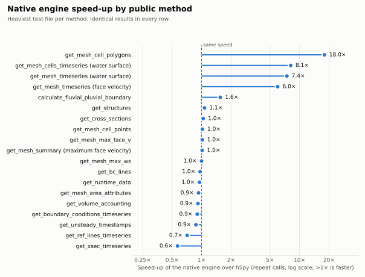
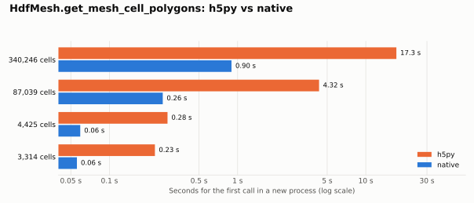

# Performance

This page compares the speed of ras-commander's public methods with the
native engine and with h5py, measured for the 0.2.0 release (with ras-commander 0.108.0).
Engine releases 0.2.1 and 0.2.2 add features and replace test fixtures but do not change read
performance, so these numbers still apply. [Tables without geometry](#tables-without-geometry)
covers a ras-commander option that is faster still for per-cell and per-face results.

The first chart shows the native speed-up for each benchmarked method; the
second shows how the cell-polygon gain changes with mesh size.





## Results

Repeat calls (warm) on the heaviest test file for each method, medians of
three fresh processes. *Native* is the default `auto` mode; `native` mode gave
the same timings within noise. Speed-up is h5py time divided by native time.

| Method | Result rows | h5py | Native | Speed-up |
|---|---:|---:|---:|---:|
| `HdfMesh.get_mesh_cell_polygons` | 340,246 | 17,252 ms | 960 ms | 18.0× |
| `HdfResultsMesh.get_mesh_cells_timeseries` (water surface) | 1 | 1,405 ms | 173 ms | 8.1× |
| `HdfResultsMesh.get_mesh_timeseries` (water surface) | 865 | 1,433 ms | 193 ms | 7.4× |
| `HdfResultsMesh.get_mesh_timeseries` (face velocity) | 865 | 1,516 ms | 253 ms | 6.0× |
| `HdfFluvialPluvial.calculate_fluvial_pluvial_boundary` | 4,569 | 10,638 ms | 6,856 ms | 1.6× |
| `HdfStruc.get_structures` | 835 | 36 ms | 34 ms | 1.1× |
| `HdfXsec.get_cross_sections` | 1,769 | 82 ms | 79 ms | 1.0× |
| `HdfMesh.get_mesh_cell_points` | 352,141 | 260 ms | 255 ms | 1.0× |
| `HdfResultsMesh.get_mesh_max_face_v` | 705,332 | 7,101 ms | 6,977 ms | 1.0× |
| `HdfResultsMesh.get_mesh_summary` (maximum face velocity) | 177,301 | 1,743 ms | 1,718 ms | 1.0× |
| `HdfResultsMesh.get_mesh_max_ws` | 340,248 | 506 ms | 506 ms | 1.0× |
| `HdfBndry.get_bc_lines` | 2 | 12 ms | 13 ms | 1.0× |
| `HdfResultsPlan.get_runtime_data` | 1 | 2.8 ms | 3.0 ms | 1.0× |
| `HdfMesh.get_mesh_area_attributes` | 0 | 1.4 ms | 1.5 ms | 0.9× |
| `HdfResultsPlan.get_volume_accounting` | 1 | 1.1 ms | 1.2 ms | 0.9× |
| `HdfResultsMesh.get_boundary_conditions_timeseries` | 4 | 16 ms | 18 ms | 0.9× |
| `HdfBase.get_unsteady_timestamps` | 865 | 5.4 ms | 6.2 ms | 0.9× |
| `HdfResultsXsec.get_ref_lines_timeseries` | 11 | 13 ms | 19 ms | 0.7× |
| `HdfResultsXsec.get_xsec_timeseries` | 5 | 8.8 ms | 15 ms | 0.6× |

- Across all 50 method × file cases (geometric mean), the native engine is
  **1.17×** faster on the first call in a process and **1.41×** faster on
  repeat calls (0.1.1 on the same machine and run: 1.07× and 1.27×).
- Every case returned identical data in `h5py`, `auto` and `native` mode: the
  benchmark hashed the normalized result (values, dtypes, columns, index, CRS
  and geometry) of every run. There were 0 errors in 1,200 runs.
- Results with few rows can still be expensive: `get_mesh_cells_timeseries`
  returns one cell's series but must locate it in a large compressed dataset.

## Tables without geometry

ras-commander's per-cell and per-face result readers return a GeoDataFrame
by default, building a Shapely point or line for every row. With
`include_geometry=False` they return a plain pandas DataFrame with the same
rows, order, values, dtypes and `attrs`, keyed by `mesh_name` and `cell_id` or
`face_id` (point readers return `x` and `y` columns). Use it when you join the
values to geometry you already have, or when you only need the numbers. The
option is on `main` and ships in the next ras-commander release after 0.108.1.

```python
from ras_commander import HdfResultsMesh

max_ws = HdfResultsMesh.get_mesh_max_ws(plan_hdf, include_geometry=False)
max_v = HdfResultsMesh.get_mesh_max_face_v(plan_hdf, include_geometry=False)
```

Default call against `include_geometry=False` on the same reader, in the
default `auto` mode: median of 7 repeat calls, and the peak memory of one call.

| Reader | File (rows) | Default | Table | Speed-up | Peak memory |
|---|---|---:|---:|---:|---:|
| `get_mesh_max_face_v` | BaldEagleDamBrk.p07 (177,301 faces) | 1,642 ms | 34 ms | 48× | 37.0 → 14.2 MiB |
| `get_mesh_max_face_v` | Homewood.p02 (161,683 faces) | 1,709 ms | 35 ms | 50× | 34.5 → 13.0 MiB |
| `get_mesh_max_depth` | Homewood.p02 (68,743 cells) | 473 ms | 24 ms | 20× | 10.0 → 4.7 MiB |
| `get_mesh_max_iter` | BaldEagleDamBrk.p07 (87,039 cells) | 104 ms | 17 ms | 6.1× | 17.7 → 5.7 MiB |
| `get_mesh_cell_points` | BaldEagleDamBrk.p07 (89,879 cells) | 60 ms | 12 ms | 5.2× | 16.7 → 6.9 MiB |
| `get_mesh_max_ws` | BaldEagleDamBrk.p07 (87,039 cells) | 114 ms | 25 ms | 4.6× | 18.4 → 7.2 MiB |
| `get_mesh_max_depth` | BaldEagleDamBrk.p07 (87,039 cells) | 770 ms | 252 ms | 3.0× | 13.0 → 6.0 MiB |
| `get_cell_bed_change` (sediment) | Weise.p01 (2,702 cells) | 175 ms | 158 ms | 1.1× | 0.69 → 0.64 MiB |

- **Face readers gain most:** the default builds a Shapely line for every face.
- **Some readers gain less:** `get_mesh_max_depth` on BaldEagleDamBrk.p07 is
  dominated by the reduction over time steps, and the sediment readers by
  their time-series read.
- **Results are identical:** the table matches the default call with its
  geometry column removed, in `h5py`, `auto` and `native` mode, on all 137
  test files.
- **Measured** on the same workstation in one process per case. This is a
  single run, so treat small differences as noise.

## Benchmark method

- **Harness:** each measurement runs in a fresh Python process. The mode is
  chosen only through `RAS_COMMANDER_FAST_HDF` (`h5py`, `auto`, `native`). The
  three modes are interleaved (h5py, auto, native, native, auto, h5py, ...) so
  drift affects them equally. Each process records the first call and two
  repeat calls. The 0.2.0 run interleaved, process by process, this release
  (engine 0.2.0 code, ras-commander 0.108.0 adapter) with 0.1.1 and the
  ras-commander it shipped with: 3 timed processes per mode and version per
  case, 1,200 processes in all, data and attribute hashes identical across
  every process of a case.
- **Cases:** 19 public methods on 7 HEC-RAS result files, from a 3,314-cell
  mesh to a mesh of about 340,000 cells and 705,000 faces.
- **Machine:** Windows 11, Intel Core i7-11700K (8 logical CPUs available to
  the VM), 48 GB RAM, Python 3.13, h5py 3.14 (HDF5 1.14.6), numpy 2.3, pandas
  2.3. No other heavy process ran during the 56-minute run: a quiet check
  before it, no build, test or HEC-RAS process before each case, and CPU
  monitored every 30 s (median 18% of the machine, about one core: the
  benchmark itself).
- **Cache:** the operating system's file cache was warm for every column;
  "first call" means a fresh process, not a cold disk. Cold-disk reads were
  not measured.

## Reading the numbers

- **Large gains** come from work the engine does in Rust that ras-commander
  used to do in Python: assembling 2D cell polygons from face topology, and
  selecting rows or cells from compressed time-series chunks without
  decompressing more than needed.
- **No gain** for whole-array summaries such as `get_mesh_max_ws` and
  `get_mesh_max_face_v` with the default GeoDataFrame result: most of the call
  is spent building a Shapely point or line for every row, which
  ras-commander does the same way in both modes. Reading and decompressing the
  values is a small part of it: the same values as a table take about 34 ms,
  against 1,642 ms for the default `get_mesh_max_face_v` call on 177,301 faces. Use [tables without geometry](#tables-without-geometry)
  when you don't need the geometry.
- **Small losses** on small reads come from a fixed cost per native read
  (proving the layout and encoding of each dataset read). Since 0.2.0 a public
  call opens each HDF once and shares that session across its reads, which
  removed most of this cost; what remains is up to about 7 ms on repeat calls
  and 37 ms on the first call in a process (`get_cross_sections` on the
  largest cross-section model).
